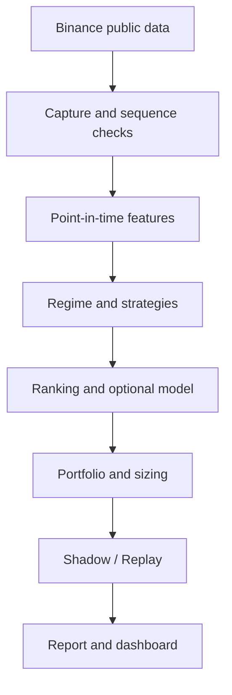

# البنية

- `market_data/` يطبّع trades وkline وmark/index/funding وopen interest وأحداث التصفية المتاحة. يستخدم عمقًا متسلسلًا للـ BBO وOFI وmarket impact. بيانات التصفية لقطات متاحة من البث، وتناقص الكمية في الدفتر لا يعرّف الإلغاء وحده.
- `regime/` و`strategies/` و`apex/engine.py` تُخرج قرارات بلا عميل تداول.
- `models/` يفصل التدريب من Python العادي عن الاستدلال المباشر على JSON مع موافقة ملفية تربط بصمة الإعدادات بالنموذج.
- `portfolio/` و`risk/apex_*.py` يحددان حدود تعرض ومحفظة ووقف في المحاكاة.
- `research/` يطبق Replay وOHLCV وتحليل الحساسية. `evaluation/` ينتج أسباب رفض الترقية ولا يبدل أدوار الاستراتيجيات.
- التشغيل الحالي `run_bot.py` و`run_demo.py` يحافظ على scanner و`DynamicPaperHunter` والتنفيذ الدائم. `baseline.json` يحكم التشغيل الموروث؛ `apex.json` يحكم البحث ويملك بصمة مستقلة.
- يحتفظ الالتقاط بطابور محدود ويخرج الكتابة الدورية عن Event Loop. التدريب عملية CLI منفصلة. إعادة التشغيل الكاملة للبحث تقرأ التسجيل من البداية لإعادة بناء الحالة.
